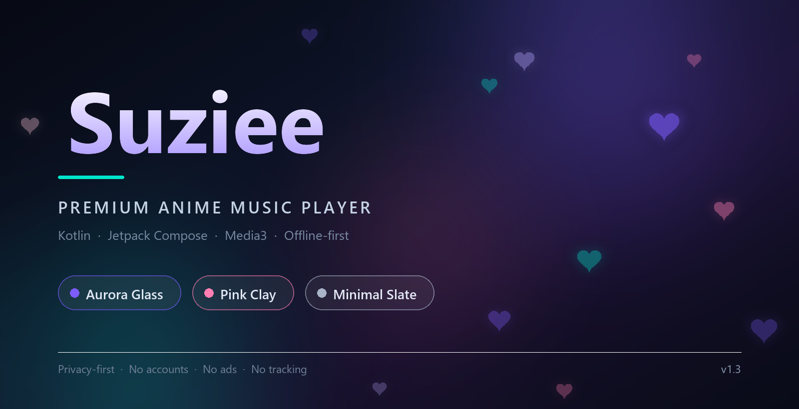

<p align="center">
  
</p>

<h1 align="center">Suziee — Premium Anime Music Player</h1>

<p align="center">
  <a href="https://github.com/heyitssuzain/Suziee/releases/latest"></a>
  <a href="https://github.com/heyitssuzain/Suziee/releases/latest"></a>
</p>

Suziee is a native Android music player crafted with **Kotlin** and **Jetpack Compose**, featuring three distinct visual themes (Aurora Glass, Pink Clay and Minimal Slate), atmospheric per-theme motion, real online music discovery, background playback with **Media3 ExoPlayer**, offline music downloads, persistent **Room** storage, synchronized **LRCLIB** lyrics with translation and offset controls, and on-device voice commands.

## 📥 Download & Install

Grab the latest APK straight from GitHub Releases — no login, no Play Store:

**https://github.com/heyitssuzain/Suziee/releases/latest/download/Suziee.apk**

1. Open the downloaded `Suziee.apk` on your Android phone (Android 8+).
2. If Android asks, allow *Install unknown apps* for your browser or file manager.
3. Install. Updating from an earlier release? Just install on top — **no uninstall needed** and your downloads, playlists and favorites are preserved.

> The release APK is signed with a private release key. Every future update uses the same key, so all users update in place forever.

## ✨ Key Features

- **Three Themes, One App** — **Aurora Glass** (refractive glassmorphism), **Pink Clay** (soft claymorphism) and **Minimal Slate** (restrained mono), each with its own home hero, palette and motion.
- **Online Music Discovery** — real search querying YouTube Music InnerTube endpoints with suggestions and metadata.
- **Block-Resistant Streaming** — a native YouTube player-API client resolves the exact requested video to a direct audio stream in about a second, with one automatic re-resolve if a stream dies mid-playback. No Python runtime and no browser engine on the playback path.
- **Download Quality Tiers** — pick High / Medium / Data-saver for downloads; the resolver walks the tier's own itag list so the order YouTube returns never downgrades you.
- **Notification & Lock Screen Controls** — title, artist and artwork with working Play/Pause, Next and Previous via Media3 `MediaSessionService`.
- **Offline Downloads** — save permitted streams (progressive + HLS stitch) into app-private storage with live progress, percentage and retry-on-failure; fully playable offline.
- **Offline Hub** — storage usage, one-tap "play all offline" and an opt-in Smart Download switch on the Home screen.
- **Configurable Home Rails** — add, remove and reset discovery rails (title + search query) from Settings.
- **Continue Listening** — grouped by artist with a per-track progress ring, so resuming is one tap.
- **Trending For Everyone** — anime trending sections **plus** mainstream sections for general listeners (Bollywood, Hindi, English and international hits).
- **Rich Lyrics** — LRCLIB synced and plain lyrics, word-by-word colour following, bilingual translation with an **A文** toggle, ±5 s offset in Settings, and three local fallbacks: sidecar `.lrc` files, ID3v2 `USLT` tags and a Genius scrape.
- **System Equalizer** — real device equalizer with presets, plus a reactive canvas visualizer.
- **Sleep Timer** — fade-out timer from the player.
- **Search That Remembers** — persisted recent searches plus Songs / Artists tabs.
- **Voice Commands** — on-device speech recognition: *"Play Believer"*, *"Next"*, *"Pause"*, *"Resume"*, *"Open lyrics"*, *"Play my downloads"*.
- **Playlists & Library** — Room-backed persistent storage for custom playlists, favorites and deduplicated playback history, with **JSON playlist export** through the system share sheet.
- **Optional Last.fm Scrobbling** — off by default; you supply your own API and session keys in Settings, and nothing is sent unless you enable it.
- **Polished Detail** — Coil artwork crossfades, next-track artwork prefetch, haptic feedback on core controls, and cache stats with a one-tap clear.

## 🆕 What's New in v1.3

- **Themes everywhere** — Pink Clay and Minimal Slate now get their own home heroes instead of the glass one.
- **More control over Home** — configurable discovery rails and a Continue Listening row grouped by artist.
- **Offline Hub** — see how much space downloads use, play everything offline, or opt into Smart Download.
- **Lyrics that fit you** — translation toggle, sync offset and three extra local sources.
- **Real device equalizer, sleep timer and haptics** across the core controls.
- **Download quality tiers**, **bilingual search tabs** with recent queries, and **JSON playlist export**.
- **Optional Last.fm scrobbling** with credentials you own.
- **Private easter egg** — a hidden dedication lives behind a deliberately obscure gesture in Settings. Its key is never stored in the app, the APK or this repository; only a one-way SHA-256 digest is committed.

## 🏗 Architecture

| Layer | Technology |
|-------|------------|
| UI | Jetpack Compose + Material 3 |
| Language | Kotlin 2.x |
| Audio | AndroidX Media3 (ExoPlayer + MediaSession) |
| Database | AndroidX Room (Tracks, Playlists, Favorites, History, Downloads) |
| Settings | AndroidX DataStore (Preferences) |
| Images | Coil Compose |
| Networking | OkHttp |

## 🔨 Build

The release APK is built **entirely on GitHub Actions** — every push to `main` runs the [`android-apk.yml`](.github/workflows/android-apk.yml) workflow, which compiles, lints, signs with the keystore from repository secrets, and publishes `Suziee.apk` to GitHub Releases.

To compile a local debug build:

```bash
gradle assembleDebug
```

The APK is generated at `app/build/outputs/apk/debug/app-debug.apk`.

## 📚 Documentation

- [`PRD.md`](PRD.md) — product requirements
- [`TRD.md`](TRD.md) — technical design
- [`docs/BUILD.md`](docs/BUILD.md) — build details
- [`docs/TESTING.md`](docs/TESTING.md) — testing
- [`NOTICE.md`](NOTICE.md) and [`docs/THIRD_PARTY_LICENSES.md`](docs/THIRD_PARTY_LICENSES.md) — notices and third-party licenses

## 🔒 Privacy-First

No signup, no mandatory accounts, no ads, no tracking, no analytics SDKs.

- Everything except stream resolution and lyrics lookup happens on-device.
- Downloads, playlists, favorites, history and settings live in app-private storage.
- **Last.fm scrobbling is opt-in and off by default.** Nothing is sent unless you paste your own API and session keys into Settings and flip the switch; no keys are bundled with the app.
- The hidden dedication is local-only and never persisted: leaving Settings forgets it. Only a one-way SHA-256 digest of its key exists in the code.
